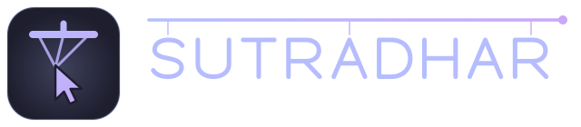
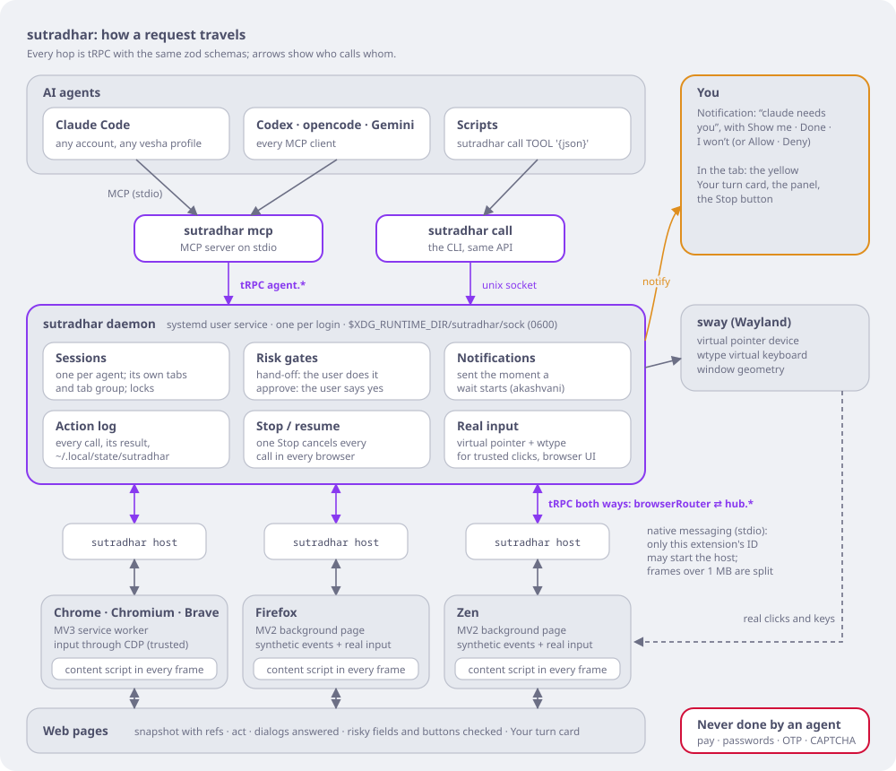
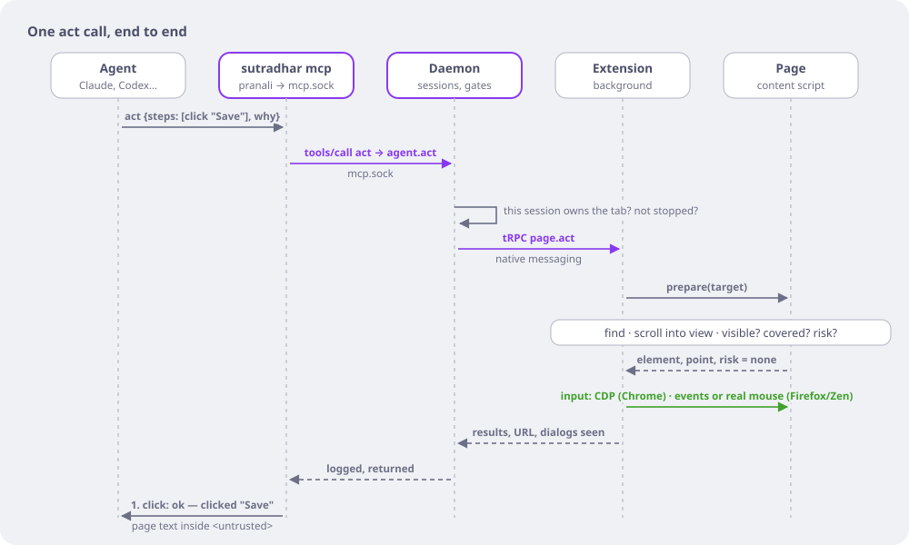
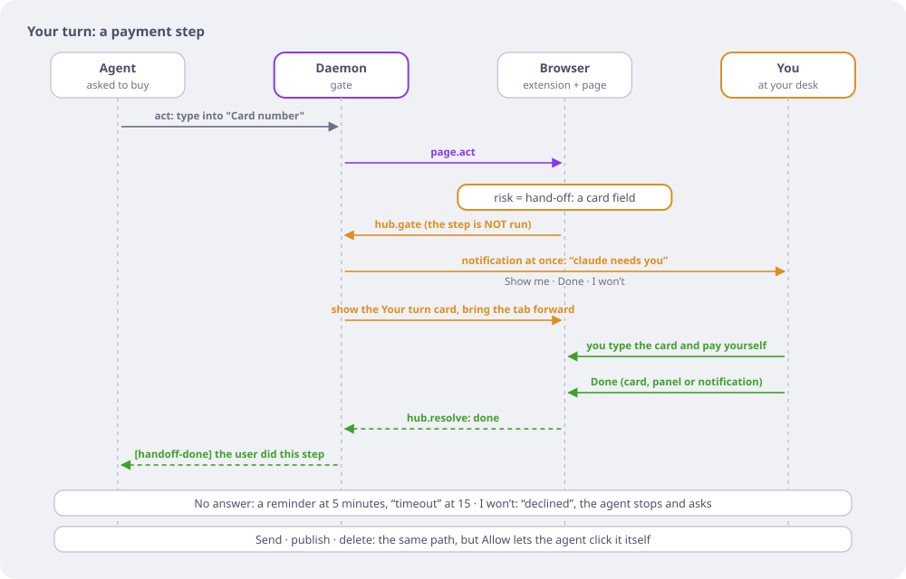

<p align="center">
  <picture>
    <source media="(prefers-color-scheme: dark)" srcset="assets/banner-dark.svg">
    <source media="(prefers-color-scheme: light)" srcset="assets/banner-light.svg">
    
  </picture>
</p>

<!-- identity -->
<p align="center">
  <b>मत्तः परतरं नान्यत्किञ्चिदस्ति धनञ्जय ।<br>
  मयि सर्वमिदं प्रोतं सूत्रे मणिगणा इव ॥</b><br>
  <i>There is nothing higher than me, Dhanañjaya: all this is strung on me, like pearls on a thread.</i><br>
  <sub>Bhagavad Gītā 7.7</sub>
</p>
<!-- /identity -->

<p align="center">
  <b>Let any AI agent use your real browser, the way you do.</b><br>
  One extension for Chrome, Firefox and Zen, one local daemon, and an MCP server every agent can talk to.
  Payments, passwords and one-time codes stay yours.
</p>

<p align="center">
  <a href="https://github.com/Theyashsawarkar/sutradhar/releases"></a>
  <a href="LICENSE"></a>
  
  
</p>

**Sūtradhāra** (सूत्रधार) is "the holder of the strings": the director who opens
and runs every Sanskrit drama. Here the agent writes the play and sutradhar
holds the strings: it moves the browser for the agent, and hands the stage back
to you whenever a step is yours.

## Contents

- [What it does](#what-it-does)
- [Install](#install)
- [Using it from an agent](#using-it-from-an-agent)
- [Your turn: what the agent never does](#your-turn-what-the-agent-never-does)
- [Tools](#tools)
- [Command line](#command-line)
- [Settings](#settings)
- [How it works](#how-it-works)
- [Security](#security)
- [Development](#development)
- [Troubleshooting](#troubleshooting)
- [License](#license)

## What it does

- **Everything a person does in a browser.** Open, switch and close tabs and
  windows; read a page as a tree of controls or as Markdown; click, double-click,
  right-click, hover, drag; type, press keys and chords; fill forms, pick
  options, tick boxes; upload files and drop them on drop zones; download
  files and read them; save a page as PDF; answer alert/confirm/prompt
  dialogs; search bookmarks and history; record a GIF of what happened.
- **Pages as they really are.** Shadow DOM (open and closed), cross-origin
  iframes, rich editors (contenteditable, ProseMirror, CodeMirror, Monaco),
  React/Vue controlled inputs, elements hidden under overlays (reported, not
  clicked blindly), infinite scroll.
- **Real mouse and keyboard when a page needs them.** Chrome gets trusted input
  through its debugger protocol. On Firefox and Zen, synthetic events cover most
  pages; when a page ignores them, sutradhar repeats the click with a real
  pointer (a virtual pointer device on sway) and real keys (wtype). The same
  hands reach what no extension may touch: the address bar, the browser's menus,
  permission prompts, file pickers.
- **Any agent.** Claude Code, Codex, opencode, Gemini, anything that speaks MCP,
  and scripts through `sutradhar call`.
- **Several browsers at once.** Chrome, Chromium, Brave, Firefox and Zen can all
  be connected; each agent picks one.
- **Safe by default.** Page text reaches the agent marked untrusted. Risky steps
  go to you. One Stop ends everything. Every action is logged.

## Install

### Requirements

| What | Why |
|---|---|
| Linux, Node.js 22.18+ | the daemon, the native-messaging host, the MCP server |
| Chrome / Chromium / Brave 116+, Firefox 128+ or Zen | the browser it drives |
| `notify-send` (libnotify) and a notification server | "your turn" notifications |
| sway (or another wlroots compositor), `wtype` | real mouse and keyboard (optional) |
| `wl-copy` / `wl-paste` | the clipboard tool |
| `ffmpeg` | `record` (GIF/WebM) |
| `pdftotext` (poppler) | reading downloaded PDFs (optional) |

### Steps

**1. The daemon and the native-messaging hosts.** In Vayu it's one command:

```sh
kosha install sutradhar     # builds it, links `sutradhar`, runs `sutradhar install`
```

Anywhere else:

```sh
git clone https://github.com/Theyashsawarkar/sutradhar ~/.local/share/sutradhar
cd ~/.local/share/sutradhar
pnpm install && pnpm build
ln -s "$PWD/bin/sutradhar" ~/.local/bin/sutradhar
sutradhar install           # native-messaging hosts for every browser found + the user service
```

`sutradhar install` writes a host manifest for every browser it finds
(Chrome, Chromium, Brave, Edge, Vivaldi in `~/.config/<browser>/NativeMessagingHosts`;
Firefox and Zen in `~/.mozilla/native-messaging-hosts`), enables
`sutradhar.service`, and prints where the extension files are.

**2. The extension, once per browser.** Browsers don't let another program put
an extension into your profile, so this step is yours. The files are in
`dist/` (or download them from a [release](https://github.com/Theyashsawarkar/sutradhar/releases)):

| Browser | File | How |
|---|---|---|
| **Zen** | `dist/sutradhar-firefox.xpi` | Zen only installs add-ons signed by Mozilla unless you allow others: open `about:config`, search `xpinstall.signatures.required`, double-click it to **false**. Then `about:addons` → gear → **Install Add-on From File…** → the `.xpi`, and allow its permissions. |
| **Chrome, Chromium, Brave** | `dist/chrome/` | `chrome://extensions` (`brave://extensions`) → turn on **Developer mode** → **Load unpacked** → the folder. Keep the folder where it is: the browser runs it from there. |
| **Firefox** | `dist/firefox/manifest.json` | Release Firefox only keeps Mozilla-signed add-ons (a signed build is coming). Until then: `about:debugging` → **This Firefox** → **Load Temporary Add-on…** → `manifest.json`; it lasts until Firefox restarts. |

Turning off `xpinstall.signatures.required` lets Zen install any unsigned
add-on, not just this one; turn it back on once a signed build is out.

**3. Check it.**

```sh
sutradhar status            # daemon: running … browsers: zen: Zen 160.0.1, extension 0.1.1
sutradhar doctor            # every piece, with a fix for anything missing
```

The toolbar button opens sutradhar's panel: green "Connected" means the
browser reached the daemon.

**4. The agents.** In Vayu, [vishvakarma](https://github.com/Theyashsawarkar/vishvakarma)
gives the MCP server to every agent (Claude Code on every account, Codex,
opencode, Gemini CLI); restart an agent's session to pick it up. Elsewhere, see below.

### Adding it to an agent by hand

```sh
claude mcp add sutradhar -- sutradhar mcp --name claude
codex mcp add sutradhar -- sutradhar mcp --name codex
```

Any other MCP client: command `sutradhar`, arguments `mcp --name <agent>`.

## Using it from an agent

A typical run:

1. `navigate` to a URL (it opens a tab in the agent's own tab group if it has none).
2. `snapshot` to read the page; every control has a ref like `e12` (`f3:e7` inside a frame):
   ```
   - page "Sign in" https://example.com/login
     - main
       - heading "Sign in" [level=1]
       - textbox "Email" [ref=e4] [required]
       - textbox "Password" [ref=e5] [required]
       - button "Continue" [ref=e6]
   ```
3. `act` with a list of steps:
   ```json
   {"steps": [{"do": "type", "ref": "e4", "value": "me@example.com"},
              {"do": "click", "ref": "e6"}],
    "why": "log in to check my order"}
   ```
4. `snapshot` again after the page changes.

Agents work only in their own tabs (and popups those open). To use one of
yours, an agent asks with `tab_attach`, and you approve it.

## Your turn: what the agent never does

The page itself checks every step, whatever the agent asked for. These are
**handed to you**:

- typing into password, card, CVV, expiry, OTP / one-time-code, PIN, UPI PIN,
  bank account or IFSC fields;
- buy, pay, place order, checkout, transfer, send money, subscribe, delete
  account and similar buttons, and submitting a form that holds card details;
- anything on a payment gateway or bank page (Razorpay, Stripe Checkout,
  PayPal, PayU, Paytm, PhonePe, Cashfree, Juspay, the big Indian banks…), and
  CAPTCHAs (reCAPTCHA, hCaptcha, Cloudflare Turnstile).

What happens:

1. **A notification goes out the moment the wait starts:** "claude needs you:
   Complete the payment yourself on example.com", with **Show me**, **Done**
   and **I won't**.
2. The tab comes to the front with a **yellow border** and a **Your turn** card
   on the page, saying what to do and why the agent wanted it.
3. You do it in the page, then press **Done** (on the card, in the toolbar
   panel or in the notification). The agent gets `handoff-done` and carries on;
   **I won't** tells it to stop and ask you.
4. A reminder after 5 minutes; after 15 the agent is told you didn't finish.

Agents can also hand you a step themselves with the `handoff` tool (log in,
solve a CAPTCHA, approve a 2FA prompt).

**Send, publish, post, delete, merge, accept, book** and similar buttons are a
lighter case: you press **Allow** and the agent clicks it. So are `eval_js`,
reading cookies or the clipboard, `tab_attach` and `os_input`. A site you
trust can skip the question (toolbar panel, or [settings](#settings)).

The card's buttons live in a closed shadow root and only answer real clicks,
so a page can't press **Done** or **Allow** for you.

## Tools

| Tool | Does |
|---|---|
| `browsers` | list connected browsers, pick one |
| `tabs`, `tab_open`, `tab_close`, `tab_focus`, `tab_update` | tabs (pin, mute, zoom, duplicate) |
| `tab_attach` | borrow one of your tabs (you approve) |
| `navigate` | URL, back, forward, reload; waits for the load |
| `snapshot` | the page as roles, names, states and refs (frames and shadow DOM included) |
| `page_text` | the main content as Markdown |
| `screenshot` | viewport, full page or one element |
| `find` | elements by text, name, role or CSS |
| `act` | click, hover, move, type, press, select, check, fill, clear, focus, scroll, drag, upload, wait |
| `dialog` | how to answer the next alert/confirm/prompt |
| `eval_js` | run JavaScript (you approve) |
| `console_read`, `network_read` | the page's console and requests |
| `wait_for` | text, element, gone, URL, network idle, download |
| `downloads` | list, start, wait, read |
| `page_pdf` | save as PDF |
| `window` | list, new (private) window, resize, maximize |
| `clipboard` | set; read (you approve) |
| `bookmarks`, `history`, `cookies` | browser data (cookies: you approve) |
| `record` | GIF or WebM of a tab |
| `handoff` | give a step to you and wait |
| `os_input` | real mouse and keyboard on the browser window (you approve) |
| `log` | the session's recent actions |

Everything Claude in Chrome's tools did maps here: `read_page` → `snapshot`,
`get_page_text` → `page_text`, `computer` → `act` + `screenshot`, `form_input` →
`act fill`, `javascript_tool` → `eval_js`, `gif_creator` → `record`,
`browser_batch` → `act`, `tabs_context_mcp` → `tabs`, `select_browser` → `browsers`.

## Command line

```
sutradhar status              what's connected: browsers, agent sessions, waiting steps
sutradhar stop                stop every agent now
sutradhar resume              let stopped agents carry on (from a terminal)
sutradhar log [-n N]          recent actions
sutradhar call TOOL [JSON]    call a tool as an agent would
sutradhar tools               the tools agents get
sutradhar install | uninstall | doctor
sutradhar mcp [--name NAME]   the MCP server (agents start this)
sutradhar daemon | host       the daemon; the native-messaging host
```

**Stop** is also the red button in the toolbar panel and on the page while an
agent acts. In Vayu, **Super+Shift+Delete** runs `sutradhar stop` from anywhere.
A stopped agent's calls fail with "the user pressed Stop" until you resume
(panel, or `sutradhar resume` in a terminal).

## Settings

`~/.config/sutradhar/config.toml` (all optional):

```toml
[handoff]
timeout_minutes = 15
reminder_minutes = 5
extra_hosts = ["pay.mybank.example"]   # more payment/bank hosts: every action there is yours

[approve]
timeout_minutes = 5

[os_input]
enabled = true       # real mouse/keyboard for Firefox/Zen and browser UI
auto_retry = true    # repeat a click the page ignored with the real mouse

[notify]
enabled = true

[sites."github.com"]
approve = "allow"    # send/publish/delete without asking here ("ask", "deny")
eval = "ask"
cookies = "deny"
```

The toolbar panel edits the `approve` and `eval` rules for the site you're on.

| Environment | |
|---|---|
| `SUTRADHAR_SOCKET` | the daemon's socket (default `$XDG_RUNTIME_DIR/sutradhar/sock`) |
| `SUTRADHAR_AGENT` | the agent's name for `mcp` and `call` |
| `SUTRADHAR_BROWSER` | the browser agents use first when several are connected (`zen`, `chrome`…) |
| `SUTRADHAR_NO_OS_INPUT` | turn the real mouse/keyboard off |

Files: the log is `~/.local/state/sutradhar/log.jsonl`; downloads saved by
`page_pdf` and `record` go to `~/Downloads/sutradhar/`.

## How it works

### The pieces

<p align="center">
  
</p>

- **Agents** start `sutradhar mcp` (an MCP server on stdio); scripts use
  `sutradhar call`. Both are thin clients: each opens a **session** on the
  daemon, named after the agent.
- **The daemon** (`sutradhar.service`, one per login) is where everything
  meets: connected browsers, agent sessions and the tabs each owns, the risk
  gates, notifications, the action log, Stop, and the real mouse and keyboard.
  It listens on `$XDG_RUNTIME_DIR/sutradhar/sock` (mode 0600). Any client
  starts it if it isn't running.
- **The native-messaging host** (`sutradhar host`) is started by each browser
  when the extension connects. It only pipes frames between the browser's
  stdio and the daemon's socket, splitting any over the browsers' 1 MB limit,
  and tells the daemon which program started it (Zen calls itself Firefox).
- **The extension** has a background part (tabs, windows, downloads,
  bookmarks, history, cookies, Chrome's debugger for trusted input and
  screenshots) and a **content script in every frame** (the snapshot and its
  refs, finding elements, synthetic input, risk checks, the dialog guard,
  the console log, and the on-page overlay and Your turn card).

### One call, end to end

<p align="center">
  
</p>

1. The agent calls `act` with steps and a `why`.
2. `sutradhar mcp` calls `agent.act` on the daemon over the unix socket.
3. The daemon checks the session may use that tab (its own tabs and the
   popups they open, or one you lent it) and that you haven't pressed Stop,
   then calls `page.act` on the extension.
4. For each step the content script finds the element (by ref, selector,
   text or point, through frames and shadow DOM), scrolls it into view, waits
   for it to settle, checks it is visible, enabled and not covered, and judges
   its **risk**.
5. With no risk, the input goes in: CDP on Chrome (trusted); careful synthetic
   events on Firefox and Zen, or the real pointer and keyboard when a step asks
   for them or a page ignored a synthetic click.
6. The results (each step's outcome, the URL, any dialogs answered) go back
   up; the daemon logs the call; the agent gets the text inside `<untrusted>`.

### When a step is yours

<p align="center">
  
</p>

The gate is in the page, not in the agent's good manners: the step never runs.
The notification goes out first, then the tab comes forward with the yellow
card. Your **Done** (from the card, the toolbar panel or the notification)
reaches the daemon, and the agent's call returns `handoff-done`. An approval
(send, publish, delete…) takes the same path, but your **Allow** lets the step
run.

### Design choices

- **tRPC on every hop.** One set of zod schemas is the input of each procedure
  and of each MCP tool, so the tool list can't drift from the code. Both ends of
  a connection serve a router: the extension serves `browserRouter` (the daemon
  calls it), the daemon serves `hub` (the extension calls it) and `agent`
  (agents call it), over one framed, two-way link
  ([`packages/protocol/src/rpc.ts`](packages/protocol/src/rpc.ts)).
- **Native messaging, not a localhost port.** Any website can reach a localhost
  port; only this extension's ID can start the native host.
- **Input.** Chrome: CDP `Input.*` (trusted). Firefox/Zen: synthetic events done
  carefully (`execCommand` for typing, so frameworks see it), and the real
  pointer (a Wayland virtual pointer device, written into the daemon) and
  keyboard (wtype) when needed. Firefox's popup blocker ignores synthetic clicks
  on new-tab links, so those open the way the click would have.
- **Dialogs** are answered in the page (alert: OK; confirm/prompt: Cancel unless
  the agent set an answer with `dialog`), so they never freeze an agent tab, and
  Chrome's debugger answers any that slip through. Outside agent tabs nothing
  changes.

The diagrams are generated by [`scripts/diagrams.py`](scripts/diagrams.py)
(light and dark in one SVG). Design notes are in [docs/adr](docs/adr/).

## Security

- Page content reaches agents inside `<untrusted>` blocks, and the MCP
  instructions tell them it is data, never orders.
- Password, card and OTP values never appear in snapshots, and the agent can't
  type into those fields.
- The socket is `0600` in your runtime dir; browsers may only call the browser
  side, agents only the agent side. A local program running as you can still
  reach the socket: sutradhar guards against web pages and misled agents, not
  against malware already on your account. `sutradhar resume` refuses to run
  without a terminal, so an agent's shell can't undo your Stop.

## Development

```sh
pnpm install
pnpm build          # dist/: daemon bundle, dist/chrome, dist/firefox, the .xpi
python3 scripts/diagrams.py   # the README's diagrams (assets/diagrams/*.svg)
pnpm typecheck
pnpm test           # unit tests (vitest)
pnpm e2e            # Chromium, Zen and Firefox in throwaway headless profiles, plus MCP
tests/e2e/nested-sway.sh   # real mouse/keyboard in a private headless sway (never your desktop)
```

The end-to-end tests run every tool against a local fixture site with the hard
cases (shadow DOM, cross-origin frames, dialogs, uploads, drag and drop, fake
payment and password pages with made-up data). They never touch your real
browser, profile, daemon or desktop.

## Troubleshooting

- **"No browser is connected"**: the extension isn't installed, or the native
  host isn't: run `sutradhar doctor`. In the browser, the toolbar panel says
  whether it reached the daemon.
- **The panel says "Not connected"**: `sutradhar install` again (the host
  manifest must point at this checkout), then restart the browser.
- **Chrome shows "is debugging this browser"**: that's how Chrome gives trusted
  input; it goes away 20 seconds after the agent's last action.
- **A click on Firefox/Zen did nothing**: pass `trusted: true` on the step, or
  check `os_input.enabled` (needs sway and `wtype`).
- **Zen says "This add-on could not be installed because it has not been
  verified"**: set `xpinstall.signatures.required` to `false` in `about:config`
  first (see [Install](#steps)).
- **Firefox won't install the .xpi**: release Firefox only takes signed add-ons;
  use the release's signed file, or Zen.

## License

[MIT](LICENSE)
